# Arquitetura do Bytebank — Fase 4

|                    |                                                                                              |
| ------------------ | -------------------------------------------------------------------------------------------- |
| **Task**           | [S4-06 — Documentação de arquitetura](./sprint-4-audit-delivery/06-architecture-docs.md)     |
| **Autor**          | Dev 2 (Arquitetura Front & Estado)                                                           |
| **Revisão**        | Dev 1 (Backend & Segurança) e Dev 3 (Performance & Plataforma)                               |
| **Base do código** | branch `phase-4` em `055ebda` (2026-11-01)                                                   |
| **Decisões**       | [ADRs 001–006](#10-adrs) · [PLAN.md](./PLAN.md) (requisitos, metas e alternativas avaliadas) |

O Bytebank é um gerenciador financeiro web: o usuário cadastra depósitos, saques e transferências, anexa recibos e acompanha saldo, gráficos e KPIs. A Fase 2 entregou o app em produção como **shell Next.js + dois microfrontends** (Module Federation). A Fase 4 não reescreveu o produto: refatorou e endureceu esse sistema em passos pequenos (padrão _Strangler Fig_), com testes de contrato e E2E protegendo o comportamento existente.

Este documento explica a arquitetura resultante para quem não acompanhou o projeto. Cada seção aponta para o código; os diagramas são Mermaid e renderizam direto no GitHub.

## Sumário

1. [Visão geral](#1-visão-geral)
2. [Camadas e regra de dependência](#2-camadas-e-regra-de-dependência)
3. [Grafo de dependências entre pacotes](#3-grafo-de-dependências-entre-pacotes)
4. [Sequência: criar transação com anexo](#4-sequência-criar-transação-com-anexo)
5. [Estado](#5-estado)
6. [Reatividade](#6-reatividade)
7. [Cache em camadas](#7-cache-em-camadas)
8. [Segurança](#8-segurança)
9. [Contratos entre MFEs](#9-contratos-entre-mfes)
10. [ADRs](#10-adrs)

### Glossário rápido

| Termo                  | Significado neste projeto                                                                                                    |
| ---------------------- | ---------------------------------------------------------------------------------------------------------------------------- |
| **Shell**              | App Next.js 16 que hospeda os MFEs, renderiza as páginas no servidor e expõe a API REST (`/api`). É o único app com backend. |
| **MFE / remote**       | Microfrontend React compilado com Rsbuild e carregado pelo shell em tempo de execução via Module Federation.                 |
| **Porta**              | Interface TypeScript declarada pela camada de aplicação (ex.: `TransactionRepository`, `FileStorage`).                       |
| **Adaptador**          | Implementação concreta de uma porta (ex.: `DrizzleTransactionRepository`, `VercelBlobFileStorage`).                          |
| **Caso de uso**        | Classe ou função que executa uma operação do negócio usando só domínio e portas (ex.: `CreateTransaction`).                  |
| **Composition root**   | Único ponto que instancia adaptadores e os injeta nos casos de uso (`container.ts`, `bootstrap.tsx`).                        |
| **Singleton federado** | Pacote carregado uma única vez e compartilhado entre shell e MFEs (React, RxJS, `@bytebank/*`).                              |

---

## 1. Visão geral

São três artefatos publicados na Vercel, um banco Postgres gerenciado (Neon) e o Vercel Blob para os arquivos. Só o shell tem código de servidor; os MFEs são builds estáticos servidos por CDN.

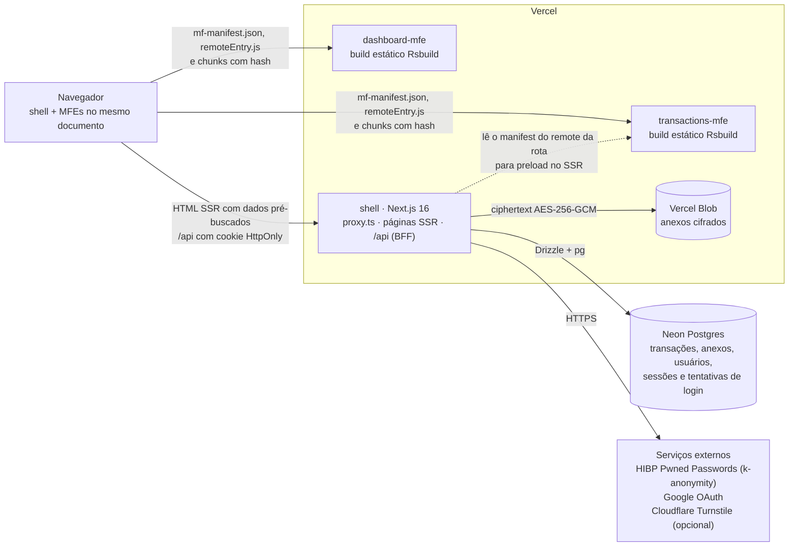

| Peça                                                   | Papel                                                                                                                                           | Expõe                                                                       |
| ------------------------------------------------------ | ----------------------------------------------------------------------------------------------------------------------------------------------- | --------------------------------------------------------------------------- |
| [`apps/shell`](../../apps/shell)                       | Host: autenticação (Auth.js), layout, SSR com prefetch, rotas `/api` (BFF), composition root do servidor, runtime do Module Federation          | `/`, `/transactions`, `/login`, `/register`, `/settings/security`, `/api/*` |
| [`apps/dashboard-mfe`](../../apps/dashboard-mfe)       | KPIs e gráficos da home (gráficos carregados sob demanda)                                                                                       | `dashboard/Dashboard`                                                       |
| [`apps/transactions-mfe`](../../apps/transactions-mfe) | Lista com filtros e busca, CRUD de transações, anexos e o widget de saldo da home                                                               | `transactions/TransactionsPage`, `transactions/AccountOverview`             |
| [`packages/*`](../../packages)                         | Código compartilhado: domínio (`core`), estado (`stores`), cliente HTTP e queries (`api-client`), Design System, utilitários legados (`shared`) | —                                                                           |

Localmente o mesmo desenho roda com Docker Compose ([`docker-compose.yml`](../../docker-compose.yml)): Postgres 16 num container acessível só por `127.0.0.1`, o shell em Node e os MFEs em nginx sem root, com os anexos num volume (`LocalFileStorage`) no lugar do Blob.

### O que acontece ao abrir `/transactions`

1. [`proxy.ts`](../../apps/shell/src/proxy.ts) confere o cookie de sessão, gera o nonce da CSP e um `x-request-id`. Sem sessão, redireciona para `/login`.
2. A página RSC [`app/transactions/page.tsx`](../../apps/shell/src/app/transactions/page.tsx) faz duas coisas em paralelo: pré-busca a primeira página da lista chamando o caso de uso direto pelo `container`, sem HTTP ([`server/prefetch.ts`](../../apps/shell/src/server/prefetch.ts)), e lê o `mf-manifest.json` do remote para emitir `<link rel="preload">` dos scripts dele ([`server/remotePreload.ts`](../../apps/shell/src/server/remotePreload.ts)).
3. O HTML chega com o estado desidratado num `HydrationBoundary`. No navegador, o estado vai para o `queryClient` compartilhado.
4. [`lib/federation.ts`](../../apps/shell/src/lib/federation.ts) carrega `transactions/TransactionsPage`. O remote usa a mesma instância de React, Redux, TanStack Query e RxJS do shell (singletons federados). Como SSR e MFE montam a query key com o mesmo código (`@bytebank/api-client/keys`), o remote encontra os dados no cache e não faz requisição ao montar.
5. Com a página pronta e o navegador ocioso, o shell pré-carrega o remote da rota provável seguinte. Passar o mouse ou focar um link interno pré-carrega o remote e os dados daquela rota ([`lib/routePreload.ts`](../../apps/shell/src/lib/routePreload.ts)). Na home, o dashboard só é buscado quando entra na viewport (`DeferUntilVisible`), e cada gráfico é um `import()` próprio.

---

## 2. Camadas e regra de dependência

A arquitetura segue Clean Architecture ([ADR-001](./adr/0001-camadas-e-pacotes.md)). O domínio e os casos de uso ficam em [`@bytebank/core`](../../packages/core), escritos em TypeScript puro, sem React, Next.js, Drizzle, `node:*` ou IO. A infraestrutura implementa as portas que o core declara. A apresentação chama casos de uso: no servidor pelo `container`, no cliente por hooks e view-models.

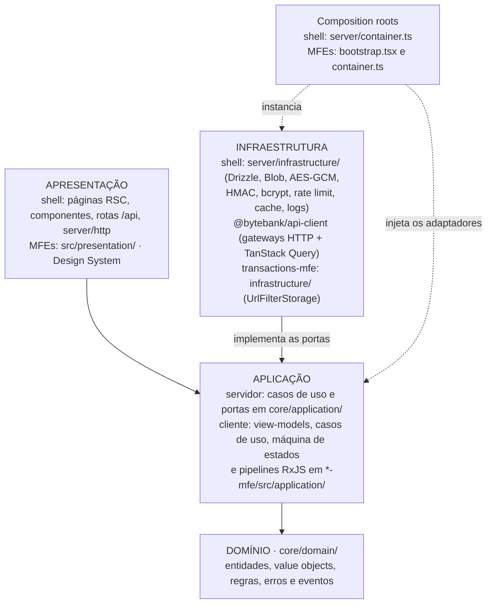

As setas sólidas mostram a direção dos imports, e **todas apontam para dentro**, até o domínio, que não importa nada. A infraestrutura depende da aplicação, e não o contrário, porque implementa as portas que a aplicação declara (inversão de dependência). As setas pontilhadas saem do composition root, o único lugar que conhece as implementações concretas e as entrega aos casos de uso. No cliente, o `api-client` é infraestrutura (fala HTTP), mas a apresentação dos MFEs o usa como fachada: chama hooks como `useTransactionsPage` sem ver `fetch`, status HTTP ou URLs.

### Pasta → camada

| Pasta                                                                                                                        | Camada                        | Conteúdo                                                                                                                                                                                                                             |
| ---------------------------------------------------------------------------------------------------------------------------- | ----------------------------- | ------------------------------------------------------------------------------------------------------------------------------------------------------------------------------------------------------------------------------------ |
| [`packages/core/src/domain/`](../../packages/core/src/domain)                                                                | Domínio                       | `Transaction`, `Money`, codec `TransactionFilter`, cálculo do resumo e KPIs, cálculo otimista, detecção de tipo por magic bytes, sugestão de categoria, erros, `DomainEvent`                                                         |
| [`packages/core/src/schemas/`](../../packages/core/src/schemas)                                                              | Domínio (validação)           | Schemas Zod (`z.strictObject`) usados igualmente pelo formulário e pela rota                                                                                                                                                         |
| [`packages/core/src/application/`](../../packages/core/src/application)                                                      | Aplicação                     | Casos de uso (`CreateTransaction`, `AddAttachment`, `AuthenticateUser`, `MfaService`…), portas, `AccessAudit`                                                                                                                        |
| [`apps/shell/src/server/infrastructure/`](../../apps/shell/src/server/infrastructure)                                        | Infraestrutura (servidor)     | Repositórios Drizzle, `VercelBlobFileStorage`/`LocalFileStorage`, `AesGcmCipher`, `HmacBlindIndex`, `BcryptPasswordHasher`, `PostgresRateLimiter`, `HibpBreachChecker`, `NextResultCache`, `NextCacheInvalidator`, `JsonAuditLogger` |
| [`apps/shell/src/db/`](../../apps/shell/src/db)                                                                              | Infraestrutura (servidor)     | Schema Drizzle, migrações, seed e scripts de backfill                                                                                                                                                                                |
| [`apps/shell/src/server/container.ts`](../../apps/shell/src/server/container.ts)                                             | Composition root              | Instancia adaptadores a partir do ambiente e injeta nos casos de uso                                                                                                                                                                 |
| [`apps/shell/src/server/http/`](../../apps/shell/src/server/http)                                                            | Apresentação (adaptador HTTP) | `route()`/`publicRoute()`: sessão → `Actor`, erro de domínio → status HTTP, ETag; leitura de upload, CORS                                                                                                                            |
| [`apps/shell/src/app/api/`](../../apps/shell/src/app/api)                                                                    | Apresentação                  | Rotas finas: traduzem a requisição e chamam um caso de uso                                                                                                                                                                           |
| [`apps/shell/src/app/`](../../apps/shell/src/app), [`components/`](../../apps/shell/src/components)                          | Apresentação                  | Páginas RSC, providers, `ClientEffects`, `NavigationBridge`, `SessionActivity`, wrappers dos remotes                                                                                                                                 |
| [`apps/shell/src/proxy.ts`](../../apps/shell/src/proxy.ts)                                                                   | Borda                         | Sessão obrigatória, checagem de origem (CSRF), CSP com nonce, request id                                                                                                                                                             |
| [`packages/api-client/src/http/`](../../packages/api-client/src/http), [`gateways/`](../../packages/api-client/src/gateways) | Infraestrutura (cliente)      | `httpClient` (status → erros do core) e gateways que implementam `TransactionGateway`/`AttachmentGateway`                                                                                                                            |
| [`packages/api-client/src/queries/`](../../packages/api-client/src/queries), `keys.ts`, `client.ts`                          | Infraestrutura (cliente)      | `queryOptions`, política de cache por tipo, mutations otimistas, query keys                                                                                                                                                          |
| [`packages/stores/`](../../packages/stores)                                                                                  | Estado do cliente             | Slices Redux, seletores, listeners, barramento de eventos, porta de navegação, `idle$`                                                                                                                                               |
| `apps/*-mfe/src/presentation/`                                                                                               | Apresentação                  | Componentes React dos MFEs                                                                                                                                                                                                           |
| `apps/*-mfe/src/application/`                                                                                                | Aplicação (cliente)           | View-models, `uploadTransactionAttachments`, máquina de estados, pipelines RxJS, porta `FilterStateStorage`                                                                                                                          |
| [`apps/transactions-mfe/src/infrastructure/`](../../apps/transactions-mfe/src/infrastructure)                                | Infraestrutura (cliente)      | `UrlFilterStorage` (filtros na URL)                                                                                                                                                                                                  |
| `apps/*-mfe/src/bootstrap.tsx`, `container.ts`                                                                               | Composition root              | Providers do modo standalone e adaptadores do MFE                                                                                                                                                                                    |
| [`packages/design-system/src/`](../../packages/design-system/src)                                                            | Apresentação                  | Atomic Design (`atoms/`, `molecules/`, `organisms/`); subpaths `/charts` e `/forms` carregados sob demanda                                                                                                                           |
| [`packages/shared/`](../../packages/shared)                                                                                  | Legado em extinção            | Reexporta símbolos migrados para o core (Strangler Fig) e guarda utilitários de apresentação (formatação, prefetch)                                                                                                                  |

### Como a regra é verificada

A regra vale porque quebra o build. Há duas verificações independentes:

- **ESLint** ([`eslint.boundaries.mjs`](../../eslint.boundaries.mjs)): `no-restricted-imports` em `error` em cada workspace (`turbo run lint` e pre-commit). Imports de símbolos que migraram do `@bytebank/shared` para o core geram aviso.
- **dependency-cruiser** ([`.dependency-cruiser.cjs`](../../.dependency-cruiser.cjs)): `npm run arch:check` roda na CI ([`ci.yml`](../../.github/workflows/ci.yml)) com caminhos resolvidos. Em 2026-11-01: **585 módulos, 1761 dependências, 0 violações**.

| Regra (depcruise)                                           | Proíbe                                                                                           |
| ----------------------------------------------------------- | ------------------------------------------------------------------------------------------------ |
| `core-puro`                                                 | Core importar React, Next, Auth.js, Drizzle, `pg`, Blob ou outro pacote/app do monorepo          |
| `core-sem-node`                                             | Core importar módulos `node:*`                                                                   |
| `mfe-isolado`                                               | MFE importar o shell, Next, Auth.js, Drizzle ou `pg`                                             |
| `shell-apresentacao-via-container`                          | Rotas, páginas, componentes e `server/http` do shell acessarem `db/` ou `server/infrastructure/` |
| `apresentacao-sem-infraestrutura`                           | Qualquer `presentation/` importar `infrastructure/`                                              |
| `atomo-sem-molecula-ou-organismo`, `molecula-sem-organismo` | Inverter a hierarquia do Atomic Design                                                           |
| `nao-resolvido`                                             | Import que não resolve (sem ela, um alias quebrado faria as outras regras passarem em silêncio)  |

### Padrões de projeto aplicados

| Padrão                | Onde                                                                                                                                      |
| --------------------- | ----------------------------------------------------------------------------------------------------------------------------------------- |
| Repository            | Portas `TransactionRepository`/`AttachmentRepository` (core) + `Drizzle*Repository` (shell). Toda consulta recebe `ownerId`.              |
| Adapter               | `FileStorage` → Vercel Blob ou disco; `Cipher` → AES-GCM; `FilterStateStorage` → URL; `httpClient` traduz status HTTP em erros do domínio |
| Facade                | Hooks do `api-client` escondem HTTP, cache e invalidação da apresentação                                                                  |
| Decorator             | `CachedGetTransactionsSummary` envolve `GetTransactionsSummary` com cache, sem mudar a interface                                          |
| Observer              | `domainEvents$` (RxJS) entre MFEs e listener middleware do Redux                                                                          |
| State                 | Máquina de estados do fluxo de transação ([seção 5](#máquina-de-estados-do-fluxo-de-transação))                                           |
| Composition root / DI | `server/container.ts` e bootstraps dos MFEs                                                                                               |
| Strangler Fig         | `@bytebank/shared` reexporta do core enquanto os imports migram; o lint avisa quem ainda usa o caminho antigo                             |

---

## 3. Grafo de dependências entre pacotes

Gerado pelo dependency-cruiser a partir dos imports reais (`npm run arch:graph`), sem edição manual. Fonte: [`assets/dependency-graph.mmd`](./assets/dependency-graph.mmd), regenerado em 2026-11-01 para este documento.

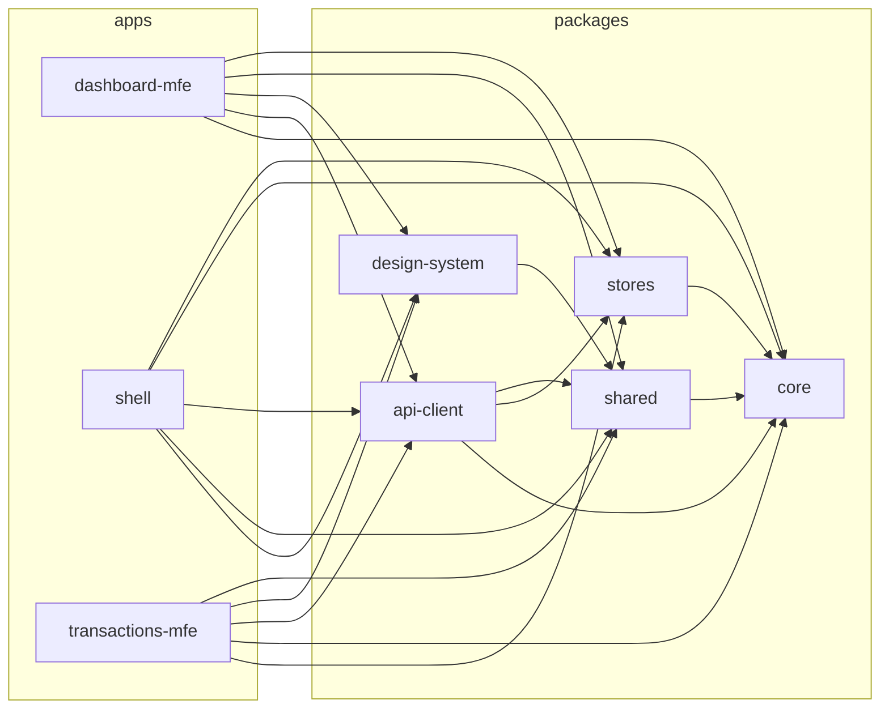

Como ler:

- **`core` só recebe setas.** É o centro da regra de dependência: todo o resto depende dele, e ele não depende de nada do monorepo.
- **Nenhuma seta entre apps.** Os MFEs não importam o shell, nem um ao outro: a integração é em tempo de execução, pelo Module Federation e pelos singletons compartilhados ([seção 9](#9-contratos-entre-mfes)).
- **Nenhuma seta de pacote para app**, e o grafo não tem ciclos.

| Pacote          | Depende de                                                | Por quê                                                                                                                      |
| --------------- | --------------------------------------------------------- | ---------------------------------------------------------------------------------------------------------------------------- |
| `core`          | —                                                         | Domínio e aplicação puros                                                                                                    |
| `shared`        | `core`                                                    | Reexporta símbolos migrados (Strangler Fig)                                                                                  |
| `design-system` | `shared`                                                  | Utilitários de classe e formatação                                                                                           |
| `stores`        | `core`                                                    | Tipos `DomainEvent` e `NavigationPort`                                                                                       |
| `api-client`    | `core`, `stores`, `shared`                                | Implementa as portas do core; publica eventos de domínio e usa a geração de sessão do `stores`; `shouldPrefetch` do `shared` |
| MFEs            | `core`, `api-client`, `stores`, `design-system`, `shared` | Consomem os pacotes; nunca o shell                                                                                           |
| `shell`         | os cinco pacotes                                          | Host e composition root                                                                                                      |

Em relação ao grafo do S1-08, surgiram `stores → core` e `api-client → stores` (barramento de eventos e expiração de sessão, Sprints 2 e 3) e `dashboard-mfe → stores/shared` (reação a eventos e sinal de conteúdo pronto, S3-08). A direção continua para dentro: o `stores` fica abaixo do `api-client` e não importa ele.

---

## 4. Sequência: criar transação com anexo

O fluxo mais completo do app atravessa todas as camadas. O usuário preenche o formulário, escolhe dois arquivos e confirma.

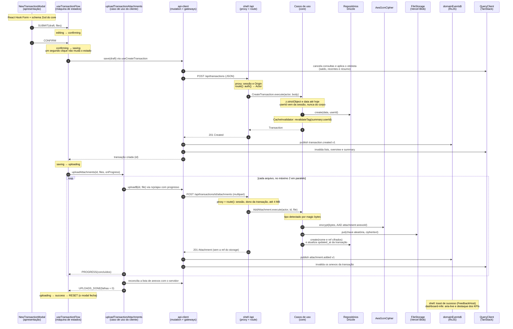

Pontos que o diagrama não mostra:

- **Rollback:** se o `POST` falhar, `onError` restaura o snapshot do cache otimista e a máquina vai para `error` ("Tentar de novo" volta para `confirming`). O otimista é calculado por funções puras do core ([`optimistic.ts`](../../packages/core/src/domain/transaction/optimistic.ts)), as mesmas regras de saldo que o servidor usa.
- **Falha parcial:** um arquivo com falha transitória (status 0 ou ≥ 500) é reenviado até 2 vezes, com espera de 1 s e 2 s. Se ainda falhar, ou se o usuário cancelar, `UPLOADS_DONE` leva a `partialSuccess`: a transação já existe e "Tentar de novo" reenvia só os arquivos que faltaram.
- **Reconciliação:** a lista de anexos é relida do servidor antes de decidir o que falhou. Assim, um upload que chegou ao servidor mas perdeu a resposta não é reenviado.
- **Feedback:** o toast de sucesso fica retido enquanto há uploads pendentes. Os erros de upload aparecem na hora, pelo listener do `uploadFailed`.
- **Sessão encerrada no meio:** logout ou expiração incrementam a geração da sessão do cliente. Respostas que chegam depois são descartadas (`ClientSessionEndedError`) e a máquina volta para `editing`, sem mostrar dados na conta seguinte.
- **Cache HTTP:** criar a transação ou o anexo muda `max(updated_at)` e a contagem do usuário, então o ETag das listas muda e o refetch recebe `200` com dados novos em vez de `304` ([seção 7](#7-cache-em-camadas)).

Código: [`NewTransactionModal.tsx`](../../apps/transactions-mfe/src/presentation/components/NewTransactionModal/NewTransactionModal.tsx) · [`useTransactionFlow.ts`](../../apps/transactions-mfe/src/application/useTransactionFlow.ts) · [`saveTransactionWithAttachments.ts`](../../apps/transactions-mfe/src/application/use-cases/saveTransactionWithAttachments.ts) · [`hooks.ts`](../../packages/api-client/src/queries/hooks.ts) · [`api/transactions/route.ts`](../../apps/shell/src/app/api/transactions/route.ts) · [`api/transactions/[id]/attachments/route.ts`](../../apps/shell/src/app/api/transactions/%5Bid%5D/attachments/route.ts) · [`use-cases/transactions.ts`](../../packages/core/src/application/use-cases/transactions.ts) · [`use-cases/attachments.ts`](../../packages/core/src/application/use-cases/attachments.ts)

---

## 5. Estado

### Taxonomia ([ADR-002](./adr/0002-taxonomia-de-estado.md))

Cada tipo de estado tem um único dono: o mecanismo que controla o ciclo de vida dele. Dado do servidor nunca é copiado para o Redux.

| Tipo de estado                                                        | Dono                          | Exemplo no código                                                                                                                                                                                                                                                                             |
| --------------------------------------------------------------------- | ----------------------------- | --------------------------------------------------------------------------------------------------------------------------------------------------------------------------------------------------------------------------------------------------------------------------------------------- |
| Dados do servidor (transações, resumo, saldo, anexos)                 | TanStack Query                | [`queryOptions.ts`](../../packages/api-client/src/queries/queryOptions.ts), [`keys.ts`](../../packages/api-client/src/keys.ts)                                                                                                                                                                |
| Global do cliente (notificações, metadados de upload, sessão exibida) | Redux Toolkit                 | [`notificationsSlice.ts`](../../packages/stores/src/notificationsSlice.ts), [`uploadsSlice.ts`](../../packages/stores/src/uploadsSlice.ts), [`authSlice.ts`](../../packages/stores/src/authSlice.ts)                                                                                          |
| Filtros, busca e página                                               | URL                           | [`useTransactionFilters.ts`](../../apps/transactions-mfe/src/application/useTransactionFilters.ts) + [`UrlFilterStorage.ts`](../../apps/transactions-mfe/src/infrastructure/UrlFilterStorage.ts) + codec [`TransactionFilter.ts`](../../packages/core/src/domain/filter/TransactionFilter.ts) |
| Campos e erros de formulário                                          | React Hook Form + Zod do core | [`TransactionForm`](../../apps/transactions-mfe/src/presentation/components/TransactionForm), [`schemas/`](../../packages/core/src/schemas)                                                                                                                                                   |
| Fluxo de várias etapas                                                | Máquina de estados (reducer)  | [`transactionFlow.ts`](../../apps/transactions-mfe/src/application/transactionFlow.ts)                                                                                                                                                                                                        |
| Eventos assíncronos                                                   | RxJS                          | [`domainEvents.ts`](../../packages/stores/src/events/domainEvents.ts), [`uploadQueue.ts`](../../apps/transactions-mfe/src/application/uploadQueue.ts), [`idle.ts`](../../packages/stores/src/reactive/idle.ts)                                                                                |
| Efêmero de um componente                                              | `useState`                    | Abertura de modais, arquivos escolhidos antes do envio                                                                                                                                                                                                                                        |

O store Redux e o `queryClient` são singletons federados: shell e MFEs leem e escrevem nos mesmos objetos. O Redux DevTools só fica ligado fora de produção ([`store.ts`](../../packages/stores/src/store.ts)).

### Padrões em uso

| Padrão                        | Como está aplicado                                                                                                                                                                                                                                            |
| ----------------------------- | ------------------------------------------------------------------------------------------------------------------------------------------------------------------------------------------------------------------------------------------------------------- |
| **Entity adapter**            | `notificationsSlice` normaliza a fila de notificações, ordenada por `createdAt`; o `FeedbackHost` mostra a mais antiga. `uploadsSlice` guarda só metadados (nome, bytes enviados, status). O objeto `File` fica num `Map` do hook, porque não é serializável. |
| **Seletores memoizados**      | `selectActiveUploads`, `selectHasPendingUploads` e `selectOverallUploadProgress` (`createSelector`), além dos seletores gerados pelo adapter                                                                                                                  |
| **Listener middleware**       | [`clientListeners.ts`](../../apps/shell/src/app/clientListeners.ts): em `logout.pending`/`clearSession`, invalida a geração de sessão, cancela uploads, limpa o `queryClient` e despacha `resetClientState`. Em `uploadFailed`, gera a notificação de erro.   |
| **Reset do root reducer**     | `resetClientState` devolve todos os slices ao estado inicial, preservando só o marcador de sessão encerrada                                                                                                                                                   |
| **Atualização otimista**      | Criar e editar aplicam o resultado esperado em saldo, recentes e resumo antes da resposta; excluir remove o item das listas. Erro restaura o snapshot, e `onSettled` invalida as chaves afetadas.                                                             |
| **Guarda de sessão**          | `createClientSessionGuard()` ([`clientSession.ts`](../../packages/stores/src/clientSession.ts)) captura a geração no início da operação; resultado de uma sessão anterior é descartado                                                                        |
| **URL como fonte de verdade** | O hook lê a URL com `useSyncExternalStore` pela porta `FilterStateStorage`. O codec do core é o mesmo no cliente, na rota `/api` e no prefetch do SSR, então os três chegam à mesma query key.                                                                |
| **Máquina de estados**        | Abaixo                                                                                                                                                                                                                                                        |

### Máquina de estados do fluxo de transação

Antes, o modal combinava `pendingData`, `isSubmitting` e o estado dos anexos, e permitia combinações inválidas (confirmar duas vezes, fechar no meio do upload). O reducer [`transactionFlow.ts`](../../apps/transactions-mfe/src/application/transactionFlow.ts) usa uma união discriminada, e o hook [`useTransactionFlow.ts`](../../apps/transactions-mfe/src/application/useTransactionFlow.ts) executa os efeitos ao entrar em cada estado. O mesmo fluxo serve à criação e à edição. Diagrama da [S3-07](./sprint-3-cache-security/07-transaction-flow-fsm.md):

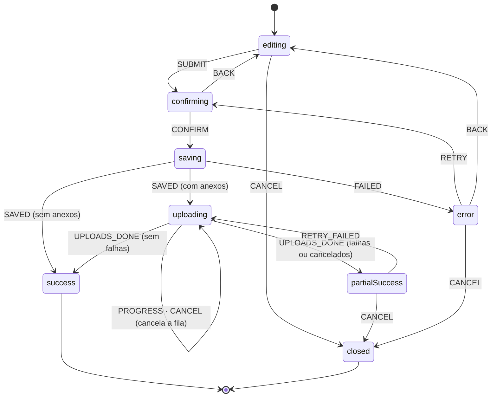

- **Evento inválido devolve o mesmo estado.** É isso que impede o duplo submit: um segundo `CONFIRM` em `saving` não faz nada. O teste de tabela cobre todos os pares estado × evento.
- **Efeitos fora do reducer.** O hook identifica cada execução pela referência do estado que a disparou. Re-render e StrictMode não repetem o `POST`, e o resultado de uma execução antiga é descartado.
- `RESET` (qualquer estado → `editing`) fica fora do diagrama: o hook o despacha depois de `success`/`closed` e quando a sessão termina no meio do fluxo.
- Cada mudança de estado é anunciada por `aria-live` ("Salvando…", "Enviando anexos 1 de 2", "Transação criada").

---

## 6. Reatividade

RxJS 7 é usado só onde há **sequências de eventos no tempo** que pedem operadores, cancelamento ou coordenação entre MFEs ([ADR-003](./adr/0003-programacao-reativa.md)). O resultado de uma busca continua no TanStack Query, e um evento nunca substitui estado nem cache. Os hooks `useEventStream`, `useSubscription` e `useObservable` ([`reactive/hooks.ts`](../../packages/stores/src/reactive/hooks.ts)) encerram as inscrições no cleanup do React. O RxJS é singleton na federação, e o lint proíbe importar subpaths (`rxjs/*`) nos MFEs para não carregar uma segunda cópia. Os pipelines têm marble tests com `TestScheduler`.

### Busca e filtros de valor

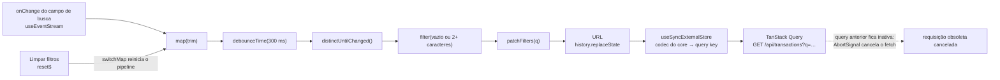

- Digitar "mercado" rapidamente gera **uma** requisição. Se o termo muda com uma requisição em voo, a query antiga perde o observador e o TanStack aborta o `fetch` pelo `signal` que o gateway repassa.
- "Limpar filtros" emite em `reset$`. O `switchMap` descarta o debounce pendente, para um termo antigo não reaparecer depois da limpeza.
- Os campos de valor mínimo e máximo usam o mesmo desenho, com `debounceTime(400 ms)` e `distinctUntilChanged()`.

Código: [`reactiveFilterPipelines.ts`](../../apps/transactions-mfe/src/application/reactiveFilterPipelines.ts) · [`useSearchStream.ts`](../../apps/transactions-mfe/src/application/useSearchStream.ts) · [`useAmountStream.ts`](../../apps/transactions-mfe/src/application/useAmountStream.ts)

### Fila de uploads

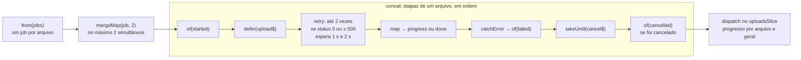

- `upload$` é um `ajax` do RxJS com `includeUploadProgress`, filtrado para eventos de progresso e de conclusão ([`AttachmentHttpGateway.ts`](../../packages/api-client/src/gateways/AttachmentHttpGateway.ts)). Um `401` publica `session.expired`.
- Cada arquivo tem o próprio `cancel$` (`ReplaySubject(1)`). "Cancelar envio" emite em todos. No logout, `cancelPendingUploads()` cancela as filas de qualquer MFE.
- `catchError` fica **dentro** do job: a falha de um arquivo não derruba a fila.
- O Redux guarda só os metadados de cada arquivo. A UI lê pelos seletores memoizados, e a máquina de estados recebe `PROGRESS` a cada arquivo concluído.

Código: [`uploadQueue.ts`](../../apps/transactions-mfe/src/application/uploadQueue.ts) · [`useUploadQueue.ts`](../../apps/transactions-mfe/src/application/useUploadQueue.ts)

### Inatividade

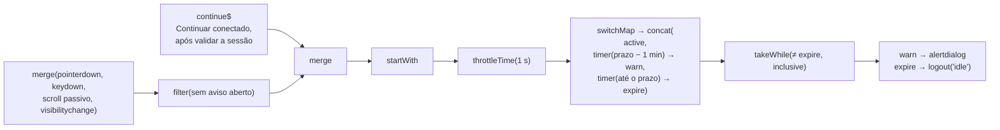

- O prazo vem de `NEXT_PUBLIC_IDLE_TIMEOUT_MINUTES` (15 min por padrão), e o aviso aparece um minuto antes.
- Cada atividade reinicia o timer pelo `switchMap`. O prazo é calculado pelo relógio absoluto: uma aba suspensa que volta depois do prazo expira na hora, sem ganhar mais um minuto.
- Com o aviso aberto, só "Continuar conectado" renova o prazo, e só depois de validar a sessão no servidor. Interação incidental não conta. O timer é por aba, e o logout é sincronizado entre abas pelo `SessionProvider`.

Código: [`idle.ts`](../../packages/stores/src/reactive/idle.ts) · [`SessionActivity.tsx`](../../apps/shell/src/app/SessionActivity.tsx)

### Eventos entre MFEs

`domainEvents$` é um `Subject` do RxJS exposto como `Observable` pelo `@bytebank/stores`. Como o pacote é singleton na federação, um evento publicado pelo transactions-mfe chega ao dashboard-mfe e ao shell (provado em build de produção no [Spike A](./sprint-0-foundation/06-risk-spikes.md)). O fluxo de cada assinante:

| Assinante                                                                                  | Pipeline                                                                                       | Efeito                                                                     |
| ------------------------------------------------------------------------------------------ | ---------------------------------------------------------------------------------------------- | -------------------------------------------------------------------------- |
| shell · [`eventBridges.ts`](../../apps/shell/src/app/eventBridges.ts)                      | `subscribe` → mapa `type → mensagem` → `notificationAdded`, só com usuário autenticado         | Toast de sucesso                                                           |
| shell · [`sessionEffects.ts`](../../apps/shell/src/app/sessionEffects.ts)                  | `subscribe` → `type === 'session.expired'` e usuário autenticado                               | `logout('expired')` com limpeza completa                                   |
| dashboard-mfe · [`Dashboard.tsx`](../../apps/dashboard-mfe/src/presentation/Dashboard.tsx) | `pipe(filter(isTransactionEvent))` → guarda os valores atuais → espera o `dataUpdatedAt` mudar | Anuncia "Dashboard atualizado" (`aria-live`) e destaca os KPIs que mudaram |

O dashboard não lê números do evento. Ele espera o refetch do TanStack e compara os valores antigos com os novos. O contrato completo está na [seção 9](#9-contratos-entre-mfes).

---

## 7. Cache em camadas

Quatro camadas reduzem transferência e recomputação sem que uma conta veja dados de outra ([ADR-005](./adr/0005-cache-em-camadas.md)). Nenhum dado financeiro é persistido no dispositivo (`localStorage`, IndexedDB ou `persistQueryClient`).

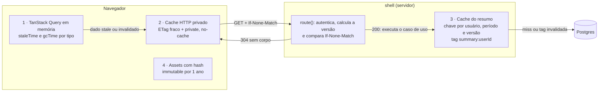

| Camada                | Política                                                                                                                                                                                                                                                                         | Invalidação                                                                                                                                                                         | Código                                                                                                                                                                                                                                                                           |
| --------------------- | -------------------------------------------------------------------------------------------------------------------------------------------------------------------------------------------------------------------------------------------------------------------------------- | ----------------------------------------------------------------------------------------------------------------------------------------------------------------------------------- | -------------------------------------------------------------------------------------------------------------------------------------------------------------------------------------------------------------------------------------------------------------------------------- |
| 1 · Cliente (memória) | Política por tipo de dado (tabela abaixo). A lista mantém a página anterior enquanto carrega a próxima e pré-busca a página seguinte.                                                                                                                                            | Mutations invalidam lists, overview e summary; logout chama `queryClient.clear()`                                                                                                   | [`cachePolicy.ts`](../../packages/api-client/src/queries/cachePolicy.ts), [`transactionViews.ts`](../../packages/api-client/src/queries/transactionViews.ts)                                                                                                                     |
| 2 · HTTP (API)        | Lista, overview e summary respondem com `ETag: W/"…"`, `Cache-Control: private, no-cache` e `Vary: Cookie`. A versão é o SHA-256 de deploy, `userId`, caminho, query ordenada e `max(updated_at):count` do usuário. A sessão é validada **antes** de comparar o `If-None-Match`. | Qualquer escrita muda `updated_at` ou `count`; anexar ou remover arquivo também atualiza a transação. Um deploy novo muda todos os ETags.                                           | [`etag.ts`](../../apps/shell/src/server/http/etag.ts), [`route.ts`](../../apps/shell/src/server/http/route.ts)                                                                                                                                                                   |
| 3 · Servidor          | `CachedGetTransactionsSummary` (decorator) guarda o resumo em `unstable_cache` por 300 s, com chave `[summary, userId, from, to, versão]` e tag `summary:<userId>`. No SSR, cada requisição cria o próprio `QueryClient`.                                                        | `CreateTransaction`, `UpdateTransaction` e `DeleteTransaction` chamam a porta `CacheInvalidator` → `revalidateTag(tag, { expire: 0 })` (expira na hora, sem stale-while-revalidate) | [`dashboard.ts`](../../packages/core/src/application/use-cases/dashboard.ts), [`NextResultCache.ts`](../../apps/shell/src/server/infrastructure/cache/NextResultCache.ts), [`NextCacheInvalidator.ts`](../../apps/shell/src/server/infrastructure/cache/NextCacheInvalidator.ts) |
| 4 · Assets públicos   | Chunks com hash dos MFEs (`/static/*`) e `_next/static` do shell: `public, max-age=31536000, immutable`. `mf-manifest.json` e `remoteEntry.js`: `no-cache`, porque mudam sem mudar de URL.                                                                                       | Deploy novo gera hashes novos                                                                                                                                                       | [`vercel.json`](../../apps/transactions-mfe/vercel.json), [`nginx.conf`](../../apps/transactions-mfe/nginx.conf)                                                                                                                                                                 |
| Sem cache             | Rotas de MFA e download de anexo usam `private, no-store`                                                                                                                                                                                                                        | —                                                                                                                                                                                   | [`attachment.ts`](../../apps/shell/src/server/http/attachment.ts)                                                                                                                                                                                                                |

Política do TanStack por tipo de dado:

| Consulta               | `staleTime` | `gcTime` | Refaz ao focar a janela | Motivo                                                   |
| ---------------------- | ----------- | -------- | ----------------------- | -------------------------------------------------------- |
| `summary` (dashboard)  | 60 s        | 10 min   | sim                     | Agregado mais caro; pode mudar em outra aba              |
| `overview` (saldo + 5) | 30 s        | 10 min   | sim                     | É o número que o usuário mais confere                    |
| `transactionsPage`     | 30 s        | 5 min    | não                     | Muitas combinações de filtro; não refazer todas ao focar |
| `transactionDetail`    | 5 min       | 10 min   | não                     | Muda só por mutation do próprio usuário, que já invalida |
| `attachments`          | 5 min       | 10 min   | não                     | Idem                                                     |

Um `GET` repetido sem mudança volta como `304` sem corpo. Depois de criar uma transação, o refetch traz `200` com o ETag novo.

---

## 8. Segurança

Defesa em profundidade: cada camada tem controles próprios, e nenhuma depende de a anterior ter barrado o ataque. A auditoria item a item contra o OWASP Top 10 e o API Security Top 10, com evidências e a varredura do OWASP ZAP, está em [`security/owasp-top10.md`](./security/owasp-top10.md) (S4-03).

| Camada                 | Controles                                                                                                                                                                                                                                                                                                                                                                                                                                                                                                                                                                                                             | Código                                                                                                                                                                                                                                             |
| ---------------------- | --------------------------------------------------------------------------------------------------------------------------------------------------------------------------------------------------------------------------------------------------------------------------------------------------------------------------------------------------------------------------------------------------------------------------------------------------------------------------------------------------------------------------------------------------------------------------------------------------------------------- | -------------------------------------------------------------------------------------------------------------------------------------------------------------------------------------------------------------------------------------------------- |
| **Navegador**          | CSP com nonce por requisição e `'strict-dynamic'`, origens dos MFEs na allowlist (`CSP_MODE`: report-only → enforce); HSTS de 2 anos com `preload`; `nosniff`; `X-Frame-Options: DENY` + `frame-ancestors 'none'`; `Cross-Origin-Opener-Policy`; `Referrer-Policy`; `Permissions-Policy`. Cookie de sessão `HttpOnly`, `Secure`, `SameSite=Lax`; nenhum token acessível ao JS ou guardado em storage. Logout e inatividade limpam TanStack, Redux e uploads.                                                                                                                                                          | [`proxy.ts`](../../apps/shell/src/proxy.ts), [`next.config.ts`](../../apps/shell/next.config.ts), [`clientListeners.ts`](../../apps/shell/src/app/clientListeners.ts)                                                                              |
| **Borda** (`proxy.ts`) | Sessão obrigatória fora de `/login`, `/register` e `/auth/error` (API → `401`, página → redirect). `POST`/`PUT`/`PATCH`/`DELETE` com `Origin` de outro site ou `Sec-Fetch-Site: cross-site` → `403` (CSRF). Request id propagado para os logs.                                                                                                                                                                                                                                                                                                                                                                        | [`proxy.ts`](../../apps/shell/src/proxy.ts)                                                                                                                                                                                                        |
| **Aplicação**          | `userId` vem sempre da sessão (`Actor`), nunca do corpo. Toda consulta do repositório filtra por dono; recurso de outra conta responde `404`, igual a inexistente, e gera o evento de auditoria `authz.denied`. Validação estrita com `z.strictObject` (campo extra → `422`). Erro inesperado devolve só `requestId`.                                                                                                                                                                                                                                                                                                 | [`route.ts`](../../apps/shell/src/server/http/route.ts), [`audit.ts`](../../packages/core/src/application/audit.ts), [`schemas/`](../../packages/core/src/schemas)                                                                                 |
| **Autenticação**       | Senha de 12 a 128 caracteres, recusada se aparecer no HIBP (k-anonymity: só 5 caracteres do hash saem do servidor); bcrypt custo 12 com rehash transparente. Limite de tentativas por e-mail (chave HMAC) e por IP em Postgres: bloqueio após 5 falhas em 15 min, dobrando até 24 h; CAPTCHA (Turnstile) exigido depois de 3 falhas, quando configurado. JWT com teto de 12 h; `sid` + `session_version` permitem revogar uma sessão ou todas (checagem a cada 5 min). MFA TOTP opcional. Detalhes no [ADR-006](./adr/0006-sessao-e-autenticacao.md).                                                                 | [`use-cases/users.ts`](../../packages/core/src/application/use-cases/users.ts), [`PostgresRateLimiter.ts`](../../apps/shell/src/server/infrastructure/db/PostgresRateLimiter.ts), [`auth.ts`](../../apps/shell/src/auth.ts)                        |
| **Dados**              | AES-256-GCM na aplicação: IV aleatório de 12 bytes, tag de 16 bytes e AAD que amarra o ciphertext ao registro (`attachment:<id>`, `user:<id>:mfa`). O payload carrega versão e `keyId`, o que permite rotação com chave antiga e nova ao mesmo tempo. Cifrados: bytes, nome e referência dos anexos; nome e e-mail do usuário, com blind index HMAC-SHA256 para o login. Descrição e valor ficam em claro para busca e filtros SQL (trade-off do [ADR-004](./adr/0004-criptografia-de-dados-sensiveis.md)). Chaves só em variáveis de ambiente. No Compose, o app conecta com o papel `bytebank_app`, que só tem DML. | [`AesGcmCipher.ts`](../../apps/shell/src/server/infrastructure/security/AesGcmCipher.ts), [`HmacBlindIndex.ts`](../../apps/shell/src/server/infrastructure/security/HmacBlindIndex.ts), [`container.ts`](../../apps/shell/src/server/container.ts) |
| **Arquivos**           | Limite de 4 MB verificado na leitura e no caso de uso. Tipo detectado por magic bytes, não pela extensão nem pelo `file.type`. Chave aleatória no storage (sem o nome original), conteúdo `application/octet-stream` cifrado. Download só pela rota autenticada, com `Content-Disposition: attachment` sanitizado, `private, no-store` e `nosniff`, auditado como `attachment.download`.                                                                                                                                                                                                                              | [`fileType.ts`](../../packages/core/src/domain/attachment/fileType.ts), [`use-cases/attachments.ts`](../../packages/core/src/application/use-cases/attachments.ts), [`attachment.ts`](../../apps/shell/src/server/http/attachment.ts)              |
| **Logs de segurança**  | Eventos em JSON (`auth.login.*`, `auth.register`, `auth.session.revoked`, `rate_limit.hit`, `authz.denied`, `attachment.download`, `csp.violation`) com e-mail mascarado, IP como HMAC e `requestId`. Segredos, códigos e conteúdo não vão para o log.                                                                                                                                                                                                                                                                                                                                                                | [`JsonAuditLogger.ts`](../../apps/shell/src/server/infrastructure/logging/JsonAuditLogger.ts)                                                                                                                                                      |
| **Infraestrutura**     | Containers não-root, `read_only`, `no-new-privileges` e `cap_drop`; Postgres publicado só em `127.0.0.1`, com senha obrigatória por `.env`.                                                                                                                                                                                                                                                                                                                                                                                                                                                                           | [`docker-compose.yml`](../../docker-compose.yml), [`docker/`](../../docker)                                                                                                                                                                        |
| **Pipeline**           | `npm audit --omit=dev --audit-level=high` como gate, gitleaks no histórico, Semgrep (`owasp-top-ten`, `typescript`, `react`), Trivy nas três imagens, Dependabot; varredura ZAP baseline na S4-03.                                                                                                                                                                                                                                                                                                                                                                                                                    | [`security.yml`](../../.github/workflows/security.yml), [`dependabot.yml`](../../.github/dependabot.yml)                                                                                                                                           |

Os MFEs não recebem confiança especial (zero trust entre MFEs): não veem o JWT, falam só com `/api/*` pelo mesmo cookie do usuário e passam pela mesma autenticação, autorização e validação de qualquer cliente.

---

## 9. Contratos entre MFEs

Os MFEs não importam uns aos outros nem o shell (regra `mfe-isolado`). Tudo que atravessa a fronteira passa por um destes quatro contratos. Mudar qualquer um deles exige coordenar o deploy dos três projetos.

### 9.1 Módulos expostos e singletons

| Contrato             | Valor                                                                                                                                                                                    | Onde                                                                                        |
| -------------------- | ---------------------------------------------------------------------------------------------------------------------------------------------------------------------------------------- | ------------------------------------------------------------------------------------------- |
| Módulos expostos     | `dashboard/Dashboard`, `transactions/TransactionsPage`, `transactions/AccountOverview`. Os nomes são API pública: mover o arquivo não muda o nome exposto.                               | `rsbuild.config.ts` de cada MFE                                                             |
| Endereço dos remotes | `NEXT_PUBLIC_DASHBOARD_MFE_URL` e `NEXT_PUBLIC_TRANSACTIONS_MFE_URL` apontam para o `mf-manifest.json` de cada deploy                                                                    | [`federation.ts`](../../apps/shell/src/lib/federation.ts)                                   |
| Singletons           | `react`, `react-dom` (19), `rxjs` (`^7.8.0`) e os pacotes `@bytebank/core`, `shared`, `stores`, `api-client`, `design-system`. O shell fornece as instâncias e os remotes as reutilizam. | `shared` do `rsbuild.config.ts` e [`federation.ts`](../../apps/shell/src/lib/federation.ts) |
| Query keys           | `@bytebank/api-client/keys` é usado pelo prefetch do SSR (shell) e pelos hooks dos MFEs; uma key divergente faria o remote buscar de novo o que o SSR já trouxe                          | [`keys.ts`](../../packages/api-client/src/keys.ts)                                          |

Como os pacotes `@bytebank/*` vêm do shell, uma mudança no core, no `stores` ou no Design System só chega aos MFEs depois de um novo build do shell.

### 9.2 Eventos de domínio `version: 1`

Definidos em [`packages/core/src/domain/events.ts`](../../packages/core/src/domain/events.ts) como união discriminada, publicados e assinados por [`domainEvents.ts`](../../packages/stores/src/events/domainEvents.ts) (`publish`, `domainEvents$`, `ofType`).

| Evento                | Payload                         | Publicado por                                                                                      | Assinado por                                      |
| --------------------- | ------------------------------- | -------------------------------------------------------------------------------------------------- | ------------------------------------------------- |
| `transaction.created` | `transaction: Transaction`      | `useCreateTransaction` (`onSuccess`)                                                               | shell (toast), dashboard-mfe (anúncio e destaque) |
| `transaction.updated` | `transaction: Transaction`      | `useUpdateTransaction` (`onSuccess`)                                                               | shell (toast), dashboard-mfe                      |
| `transaction.deleted` | `id: string`                    | `useDeleteTransaction` (`onSuccess`)                                                               | shell (toast), dashboard-mfe                      |
| `attachment.added`    | `transactionId`, `attachmentId` | `useUploadAttachment` (mutation e stream)                                                          | shell (toast)                                     |
| `attachment.removed`  | `transactionId`, `attachmentId` | `useDeleteAttachment` (`onSuccess`)                                                                | shell (toast)                                     |
| `session.expired`     | —                               | `httpClient` e `upload$` ao receber `401`; `SessionActivity` e `SessionSync` (logout em outra aba) | shell (`logout('expired')`)                       |

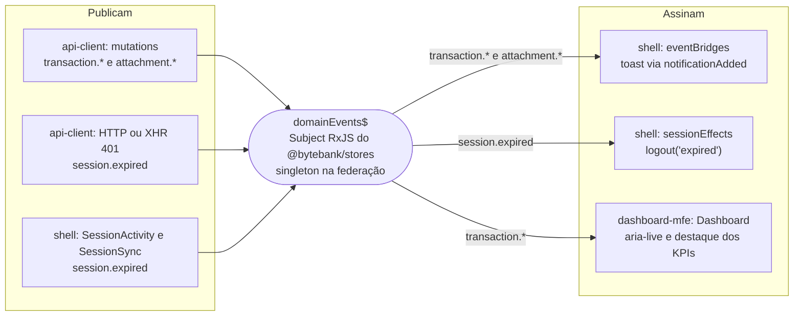

Regras do contrato:

1. **Evento é notificação, não fonte de dados.** Os números continuam vindo do TanStack Query, por invalidação. O payload de `transaction.*` existe para quem precisar identificar o item, não para substituir o cache.
2. **Sem replay.** O barramento é um `Subject` simples: quem assina depois não recebe eventos antigos, e nenhum estado financeiro fica guardado nele.
3. **Versão explícita.** Toda variante carrega `version: 1`. Uma mudança incompatível entra como uma nova variante (`version: 2`) ao lado da antiga, até todos os MFEs publicados entenderem a nova. Assim, shell e remotes podem ser publicados em momentos diferentes.
4. **Assinante ignora o que não conhece.** Os assinantes filtram por `type` (`ofType` ou `filter`); um tipo novo não quebra quem ainda não o trata.
5. **Inscrição com teardown.** Toda assinatura é encerrada no cleanup do efeito React ou pela função de parada registrada no `ClientEffects`.

### 9.3 Porta de navegação

O MFE não pode usar `next/navigation`: ele roda fora do Next (o import é desligado por alias no rsbuild). Para navegar sem recarregar o documento, o core define a porta [`NavigationPort`](../../packages/core/src/application/ports/NavigationPort.ts) (`navigate(path)`, `prefetch(path)`), e o `@bytebank/stores` mantém o registro da implementação atual ([`navigation.ts`](../../packages/stores/src/navigation.ts)).

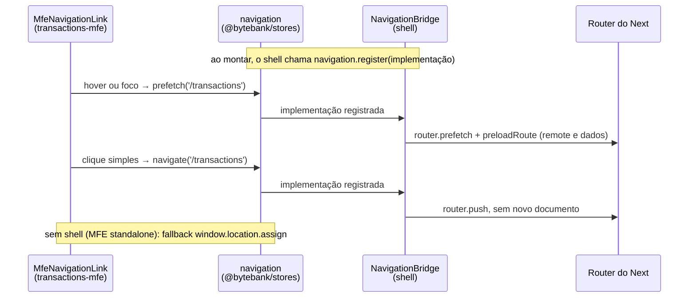

O link continua sendo um `<a href>` real: funciona sem JS, abre em nova aba e é anunciado como link. Só o clique simples (botão esquerdo, sem Ctrl, Cmd, Shift ou Alt, sem `target` nem `download`) é interceptado ([`MfeNavigationLink.tsx`](../../apps/transactions-mfe/src/presentation/components/MfeNavigationLink.tsx)).

### 9.4 Estado compartilhado

O store Redux e o `queryClient` são os mesmos objetos no shell e nos remotes. O shell registra os efeitos globais (listeners do logout, ponte de eventos, aviso de upload pendente, expiração de sessão) uma única vez em [`ClientEffects.tsx`](../../apps/shell/src/app/ClientEffects.tsx). Os MFEs só despacham ações e leem seletores tipados. No modo standalone, o `bootstrap.tsx` de cada MFE monta os próprios providers com as mesmas instâncias dos pacotes.

---

## 10. ADRs

As decisões de arquitetura ficam em [`docs/phase-4/adr/`](./adr), no formato do [template](./adr/0000-template.md): contexto, decisão, alternativas e consequências.

| ADR                                                  | Título                                              | Decisão                                                                                                                                              | Status              |
| ---------------------------------------------------- | --------------------------------------------------- | ---------------------------------------------------------------------------------------------------------------------------------------------------- | ------------------- |
| [001](./adr/0001-camadas-e-pacotes.md)               | Camadas e pacotes da arquitetura alvo               | `@bytebank/core` em TypeScript puro (domínio + aplicação), infraestrutura nas bordas, composition roots; REST mantido em vez de GraphQL              | aceito · 2026-09-28 |
| [002](./adr/0002-taxonomia-de-estado.md)             | Taxonomia de estado no cliente                      | Cada tipo de estado no mecanismo que controla o ciclo de vida dele; dados do servidor só no TanStack Query                                           | aceito · 2026-09-28 |
| [003](./adr/0003-programacao-reativa.md)             | Programação reativa para streams de eventos         | RxJS 7 só para streams (busca, upload, inatividade, eventos entre MFEs), compartilhado como singleton na federação                                   | aceito · 2026-09-28 |
| [004](./adr/0004-criptografia-de-dados-sensiveis.md) | Criptografia de dados sensíveis                     | AES-256-GCM na aplicação para anexos e PII, blind index HMAC para o e-mail; descrição e valor em claro para SQL                                      | aceito · 2026-09-28 |
| [005](./adr/0005-cache-em-camadas.md)                | Cache em camadas sem compartilhar dados financeiros | ETag privado, cache de servidor por usuário com tags, TanStack por tipo de dado, assets `immutable`; nada persistido no dispositivo                  | aceito · 2026-09-28 |
| [006](./adr/0006-sessao-e-autenticacao.md)           | Sessão e autenticação                               | Limite de tentativas em Postgres (e-mail com HMAC + IP), JWT com `sid` e `session_version` revogáveis, teto de 12 h, inatividade de 15 min, MFA TOTP | aceito · 2026-10-18 |

Alternativas descartadas no nível do plano (XState, GraphQL, Redis para rate limit, SSR real dos MFEs, `pgcrypto`, persistência do cache) estão em [PLAN.md — Alternativas avaliadas](./PLAN.md#alternativas-avaliadas).

---

## Como verificar

| O quê                                        | Comando                                                              |
| -------------------------------------------- | -------------------------------------------------------------------- |
| Regras de fronteira entre camadas e pacotes  | `npm run arch:check`                                                 |
| Regerar o grafo da seção 3                   | `npm run arch:graph`                                                 |
| Testes unitários, marble tests e stories     | `npx vitest`                                                         |
| Integração com Postgres (repositórios, ETag) | `npm run test:integration -w @bytebank/shell` (exige `DATABASE_URL`) |
| E2E dos fluxos (Chromium e Firefox na CI)    | `npx playwright test`                                                |

Para rodar o projeto localmente, veja o [README](../../README.md).
