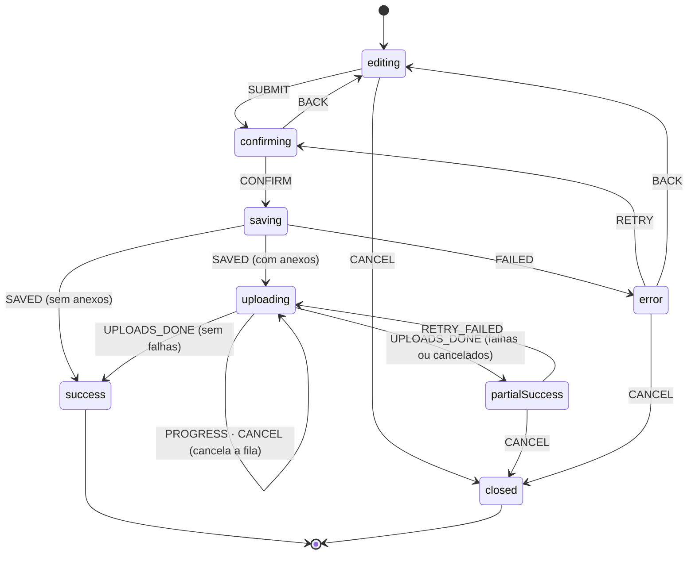

# Task 07 — Máquina de estados do fluxo de transação

|                 |                                                                                   |
| --------------- | --------------------------------------------------------------------------------- |
| **Sprint**      | [Sprint 3 — Cache e criptografia](./README.md)                                    |
| **Owner**       | Dev 2 (Arquitetura Front & Estado)                                                |
| **Duração**     | 1.5 dia                                                                           |
| **Prioridade**  | P1                                                                                |
| **Branch**      | `dev2-arch/transaction-flow-fsm`                                                  |
| **Depende de**  | S2-03 (fila de uploads), S1-07 (`saveTransactionWithAttachments`)                 |
| **Desbloqueia** | S4-06 (diagrama de estados na documentação)                                       |
| **Requisito**   | State Management Patterns avançados                                               |
| **Embasamento** | Princípios e Padrões — Aula 2 (padrão State) e Aula 4 (State Management Patterns) |

---

## Contexto

O `NewTransactionModal` controla o fluxo com `pendingData`, `isSubmitting` e o estado do `useAttachments`: combinações inválidas são possíveis (confirmar duas vezes, fechar no meio do upload) e cada tela reimplementa o fluxo. Uma máquina de estados torna os estados e as transições explícitos e testáveis.

## Estados



`RESET` (qualquer estado → `editing`) fica fora do diagrama: o hook o despacha depois de `success`/`closed`, para reabrir o modal limpo, e quando a sessão termina no meio do fluxo.

## Implementação

1. **Reducer puro** (`application/` do transactions-mfe), com união discriminada:

   ```ts
   type FlowState =
     | { value: 'editing' }
     | { value: 'confirming'; draft: TransactionFormValues }
     | { value: 'saving'; draft: TransactionFormValues }
     | { value: 'uploading'; transactionId: string; done: number; total: number }
     | { value: 'partialSuccess'; transactionId: string; failed: File[] }
     | { value: 'success' }
     | { value: 'error'; draft: TransactionFormValues; reason: string };

   export function transactionFlow(state: FlowState, event: FlowEvent): FlowState {
     switch (state.value) {
       case 'editing':
         return event.type === 'SUBMIT' ? { value: 'confirming', draft: event.draft } : state;
       case 'confirming':
         if (event.type === 'CONFIRM') return { value: 'saving', draft: state.draft };
         if (event.type === 'BACK') return { value: 'editing' };
         return state;
       // ...demais estados
     }
   }
   ```

2. **Hook `useTransactionFlow()`:** junta o reducer com os efeitos — ao entrar em `saving`, chama o caso de uso; em `uploading`, assina a fila (S2-03) e despacha `PROGRESS`/`UPLOADS_DONE`. A UI só lê `state.value` e envia eventos.
3. **UI:** modal de confirmação aberto em `confirming` e `saving`; barra de progresso em `uploading`; botão "Tentar de novo" em `partialSuccess`; anúncios com `aria-live="polite"` a cada mudança de estado.
4. Aplicar em `NewTransactionModal` e `EditTransactionModal`.

## Notas de implementação

- **Decisões:** a edição também passa pela confirmação (`ConfirmTransactionModal mode="edit"`, "Confirmar alteração"). No `partialSuccess` há um único "Tentar de novo", que reenvia todos os anexos que falharam ou foram cancelados. O retry por arquivo continua só na edição, onde os anexos sobem na hora.
- **Arestas além do rascunho:** `closed` é um estado final explícito, para o teste de tabela diferenciar CANCEL válido de ignorado. `error` aceita `BACK` (corrigir o formulário) e `CANCEL`. `CANCEL` em `uploading` marca `cancelling` e cancela a fila; o `UPLOADS_DONE` com os cancelados leva a `partialSuccess` (gotcha 3).
- **Reducer** (`application/transactionFlow.ts`): genérico no rascunho, para a camada application não depender do tipo do formulário. Evento inválido devolve a mesma referência, e `PROGRESS` repetido também.
- **Hook** (`application/useTransactionFlow.ts`): recebe `save`, `uploadAttachments`, `cancelUploads` e `onFinish`, e tem um efeito por entrada de estado. O id de execução é a identidade do que disparou o passo: o objeto `saving` ou o array `files` do `uploading`, que o `PROGRESS` preserva e o `RETRY_FAILED` troca. Re-render e StrictMode não repetem a chamada, e resultado de execução antiga é descartado. `ClientSessionEndedError` volta para `editing` sem mostrar erro.
- **Caso de uso e fila:** `uploadTransactionAttachments` saiu do `saveTransactionWithAttachments` (upload + reconcile), que agora o compõe. `useUploadQueue.uploadFiles` aceita um observador dos eventos do lote; o adaptador `useSaveTransactionWithAttachments` conta os eventos terminais para despachar `PROGRESS` e limpa as entradas antigas antes de cada lote.
- **UI:** a confirmação fica aberta em `confirming`, `saving` e `error` (alerta + "Voltar"/"Tentar de novo"). `uploading` mostra a barra geral (`role="progressbar"`) e o progresso e o cancelamento por arquivo (`AttachmentList`); `partialSuccess` explica que a transação já existe e lista o que falhou. O foco vai para o painel quando ele aparece. O `Escape` do modal de baixo é ignorado enquanto a confirmação está aberta, para não disparar `BACK` e `CANCEL` juntos. Durante o `uploading`, `Escape` e o X não fecham (como antes, quando o envio inteiro bloqueava o fechamento): um `FeedbackModal` de erro ("Erro ao enviar X") pode abrir por cima enquanto os outros arquivos sobem, e ele escuta o mesmo `Escape`, então fechá-lo cancelaria o resto do envio. O de sucesso não abre nessa hora, porque o `FeedbackHost` segura o sucesso enquanto há uploads pendentes. O cancelamento é explícito pelo botão "Cancelar envio".
- **Anúncios:** `TransactionFlowStatus` (`role="status"`, `aria-live="polite"`) fica fora do `<Modal>`, para o "Transação criada" sobreviver ao fechamento: "Salvando…", "Enviando anexos N de T", "Transação criada" / "Alterações salvas", "Transação criada, mas N anexo(s) não foram enviados". O erro é anunciado pelo `role="alert"` da confirmação. O feedback de sucesso continua vindo do evento de domínio (S2-04).

## Testes

- [x] Tabela de transições: todas as válidas; eventos inválidos ignorados (mesmo estado) — `transactionFlow.test.ts`, todos os pares estado × evento
- [x] Hook com caso de uso e uploader falsos: sucesso, falha parcial com retry, erro com retry — `useTransactionFlow.test.tsx`, mais CONFIRM duplo, StrictMode, cancelar no upload, sessão encerrada e resultado tardio
- [x] Stories: confirmação de edição, erro com "Tentar de novo", duplo clique na edição salva uma vez, anúncios do `TransactionFlowStatus`
- [x] E2E `transaction-flow.spec.ts` (Chromium e Firefox): duplo clique → 1 `POST`; falha parcial → retry só do que falhou; sequência de anúncios, com `Escape` durante o envio sem cancelar nada. A edição com confirmação passou a valer em `attachment.spec.ts` e no `sprint2-smoke.spec.ts` (helper `confirmTransactionUpdate`)

## Validação

- [x] Duplo clique em "Confirmar" cria uma única transação (E2E conta os `POST`)
- [x] Falha parcial de upload mostra o que falhou e permite tentar de novo (E2E com o `POST` de um anexo recusado)
- [x] Leitor de tela anuncia "Salvando…", "Enviando anexos 1 de 3", "Transação criada"

## Gotchas

1. Transição inválida devolve o mesmo estado — é isso que evita o duplo submit.
2. Efeitos ficam fora do reducer (reducer puro). No StrictMode o efeito roda duas vezes em dev: use um id de execução para não criar a transação duas vezes.
3. Cancelar durante `uploading` cancela a assinatura da fila, mas a transação já existe: leve o usuário para `partialSuccess` com a explicação.
